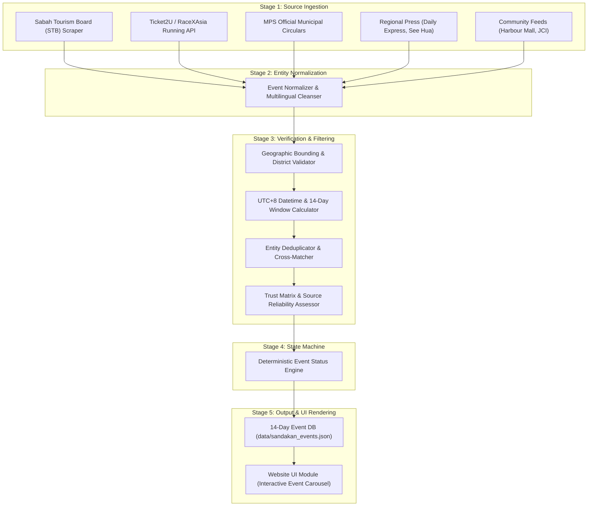
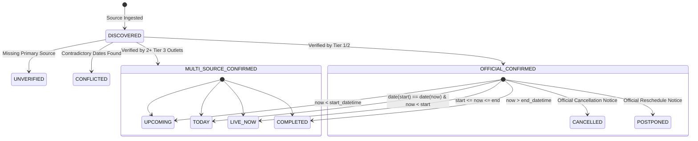

# Sandakan 14-Day Event Engine — Technical Architecture & System Design
**Project:** Sabah Daily News / 西门看看网  
**System Component:** Independent Event Aggregation, Verification, and Forecast Pipeline  
**Design Version:** 1.0.0-PROD-SPEC  
**Author:** Core Engineering & Data Integrity Architecture  
**Execution Target:** Deterministic, High-Reliability Python Pipeline (`scripts/sandakan_event_engine.py`)  

---

## 1. System Overview & Design Principles

The **Sandakan 14-Day Event Engine** is a dedicated, zero-hallucination event intelligence sub-pipeline designed to discover, verify, normalize, and publish real-world public events occurring within the administrative district of Sandakan, Sabah, over a rolling 14-day forward window.

### Core Architecture Principles:
1. **Separation of Concerns:** The Event Engine operates completely decoupled from the news aggregation pipeline (`agent_reach_editor.py` / `build_news.py`). An error or network hiccup in event collection will never break the daily news build.
2. **Deterministic Grounding (Zero Hallucination):** No event may enter the published database based solely on generative model completion. Every event entity must cite at least one validated primary source URL with a verified HTTP status, domain reputation score, and extracted evidence snippet.
3. **Strict Zero-LLM Fallback:** The core engine must be 100% executable without external AI APIs (e.g., Gemini API quota exhaustion or zero-cost execution modes). Rule-based regex tokenizers, geographic gazetteers, and deterministic datetime arithmetic drive the classification. LLM capabilities are strictly confined to an optional translation enhancement layer.
4. **Resilient Local Persistence:** Event entities are versioned and stored in structured JSON format (`data/sandakan_events.json`), backed by an immutable historical archive (`data/archive/sandakan_events_history.jsonl`).

---

## 2. End-to-End Pipeline Architecture

The Event Engine processes data through an 8-stage unidirectional pipeline:

---

## 3. Detailed Component Specifications

### 3.1 Stage 1: Modular Source Collectors (`collectors/`)
Each collector is implemented as an isolated class inheriting from `BaseEventCollector`:

1. **Sabah Tourism Board Collector (`STBCollector`):**
   - *Target:* `https://sabahtourism.com/events/`
   - *Extraction:* Parses JSON-LD Schema (`schema.org/Event`) embedded in the WordPress theme.
   - *District Filtering:* Matches taxonomy terms `location: Sandakan`.
   - *Cadence:* Daily at 04:00 MYT.
2. **Ticketing & Sports Collector (`TicketingCollector`):**
   - *Target:* `https://www.ticket2u.com.my/` and `https://www.asiaruncalendar.com/`
   - *Extraction:* Queries Sandakan venue coordinates and district tags (`Sandakan`, `Sibuga`, `Sepilok`, `Elopura`).
   - *Fields Extracted:* Category, Flag-off times, REPC collection hours, registration URLs.
3. **MPS Municipal Collector (`MPSNoticeCollector`):**
   - *Target:* `https://mps.sabah.gov.my/` (Siaran Media / Pengumuman)
   - *Extraction:* Traverses official PDF announcements and press notices for official civic, gotong-royong, and public ceremonial schedules.
4. **Regional Mainstream Media Collector (`PressEventCollector`):**
   - *Target:* Daily Express Sabah, TV Sarawak, Sin Chew Daily (Sabah), See Hua Daily (Sandakan bureau).
   - *Extraction:* Scrapes sports, civic, and cultural sections; filters for upcoming dates and keywords (*Kejohanan*, *Pameran*, *Festival*, *比赛*, *嘉年华*, *锦标赛*).

---

### 3.2 Stage 2: Geographic Verification Engine (`geo_verifier.py`)
To prevent false-positive events from Kota Kinabalu or Tawau leaking into the Sandakan forecast:
- **Sandakan Bounding Box:**
  - Latitude: `5.5000° N` to `6.1500° N`
  - Longitude: `117.6000° E` to `118.3500° E`
- **Mandatory Whitelist Keywords:**
  `Sandakan`, `Bandar Sandakan`, `Sepilok`, `Sibuga`, `Elopura`, `Tanjong Papat`, `Karamunting`, `Batu Sapi`, `Gum-Gum`, `Sungai Manila`, `Mile 1` through `Mile 32`, `RDC`, `Kompleks Sukan Sandakan`, `Harbour Mall Sandakan`, `Dewan Masyarakat Sandakan`.
- **Blacklist / Exclusion Filter:**
  Any event matching `Likas`, `Penampang`, `Kota Kinabalu`, `Tawau`, `Lahad Datu`, `Keningau`, or `Labuan` without an explicit Sandakan qualifier is rejected immediately with code `GEO_REJECT_OUT_OF_DISTRICT`.

---

### 3.3 Stage 3: Chronological & Rolling Window Calculation Engine
All calculations use strict `Asia/Kuala_Lumpur` (UTC+08:00) standard time.

Let $T_{\text{now}}$ be the current system execution timestamp.  
Let $[T_{\text{window\_start}}, T_{\text{window\_end}}]$ define the rolling 14-day window:
$$T_{\text{window\_start}} = T_{\text{now}}$$
$$T_{\text{window\_end}} = T_{\text{now}} + 14 \text{ days (23:59:59 MYT)}$$

#### Event Retention Rules:
1. **Active Event (`LIVE_NOW`):**
   $$T_{\text{start}} \le T_{\text{now}} \le T_{\text{end}}$$
   *Retained in publication feed.*
2. **Today's Event (`TODAY`):**
   $$\text{Date}(T_{\text{start}}) = \text{Date}(T_{\text{now}})$$
   *Retained and highlighted with high priority.*
3. **Upcoming Event (`UPCOMING`):**
   $$T_{\text{now}} < T_{\text{start}} \le T_{\text{window\_end}}$$
   *Retained in 14-day forecast.*
4. **Completed Event (`COMPLETED`):**
   $$T_{\text{end}} < T_{\text{now}}$$
   *Flagged as COMPLETED. Removed from the live upcoming carousel; transferred to historical log.*
5. **Distant Future Event:**
   $$T_{\text{start}} > T_{\text{window\_end}}$$
   *Held in database staging, suppressed from the 14-day active UI.*

---

### 3.4 Stage 4: Trust Matrix & Multi-Source Verification Engine

Every candidate is assigned a **Source Reliability Tier** and an **Event Verification Status**:

| Reliability Tier | Authority Definition | Minimum Requirements | Default Verification Status |
|---|---|---|---|
| **TIER 1: Official Statutory** | Sabah Tourism Board, MPS, Forestry Dept, Ministry of Health | Official `.gov.my` portal or licensed national registry | `OFFICIAL_CONFIRMED` |
| **TIER 2: Established Organisers** | Registered sports clubs, JCI, Lions Club, Ticket2U | Valid company/society registration, ticketing merchant | `OFFICIAL_CONFIRMED` (if solitary with ticket sale) |
| **TIER 3: Mainstream Media** | Daily Express, Sin Chew, See Hua, TVS | Formal journalist report with named official venue & date | `MULTI_SOURCE_CONFIRMED` (when 2+ outlets agree) |
| **TIER 4: Social / Community** | Facebook pages, WhatsApp flyers, forum posts | Social media announcement without registered circular | `DISCOVERED` (BLOCKED from public display) |

#### Strict Gatekeeping Rules:
- An event with verification status `DISCOVERED` or `UNVERIFIED` is **NEVER** published to the live user-facing dashboard.
- If two sources advertise contradictory dates/times (e.g., HDOK Blood Drive on 15th vs 22nd), the engine assigns `CONFLICTED` status and quarantines the event.

---

### 3.5 Stage 5: Entity Deduplication & Resolution
Events collected from multiple sources (e.g., a marathon listed on Ticket2U and reported in the Daily Express) must be merged into a single canonical record:
1. **Composite Key:** `fingerprint = SHA256(normalize(venue) + date_str + normalize(name_token))`
2. **Fuzzy String Similarity:** Token Sort Ratio $\ge 82\%$ on event titles within identical venue and date window.
3. **Merge Policy:** Retain Tier 1 metadata as primary; append Tier 3 news reports to `secondary_source_urls`.

---

## 4. Deterministic Event Status State Machine

---

## 5. Website UI & Front-End Integration Design

The website will feature a dedicated, high-visibility responsive component inserted above the general news stream:

### Component: `📅 Sandakan Events — Next 14 Days (山打根未来14天活动早知道)`
- **Header Badge:** Live count pill: `"3 Events Active & Upcoming"`.
- **Navigation Tabs:**
  - `Semua (全部 / All)`
  - `Hari Ini & Sedang Berlangsung (今天与进行中 / Live & Today)`
  - `Minggu Ini (7 Hari / 7 Days)`
  - `14 Hari Akan Datang (14 Days)`
- **Card Design Elements:**
  - **Date Ribbon:** Bold calendar date box (e.g., `22 NOV / AHAD`).
  - **Status Pill:** 
    - `🔴 SEDANG BERLANGSUNG (LIVE NOW)` with subtle pulse animation.
    - `🟡 HARI INI (TODAY)` with amber badge.
    - `🔵 AKAN DATANG (UPCOMING)` with blue badge.
  - **Bilingual Title:** Primary title based on active language toggle (Chinese / BM), with secondary subtitle.
  - **Metadata Grid:**
    - 📍 Venue: Clickable link opening Google Maps for the venue.
    - ⏰ Time: Exact start and end times in 24h format.
    - 🏛️ Organiser: Official association or ministry.
    - 🎫 Action Button: "Info Rasmi / Tiket" linking directly to the validated primary URL.

---

## 6. Safety, Error Handling & Quota Protection

1. **Zero Gemini Dependence:** All ingestion, deduplication, date calculations, and status assignments are implemented in pure standard-library Python (`json`, `datetime`, `re`, `urllib`).
2. **Stale Cache Shielding:** If a collector network request fails or times out (10s threshold), the engine uses the last known valid record from `data/sandakan_events.json` without discarding existing verified events.
3. **No Phantom Deletions:** If an event drops off a source scraper (e.g., event page moved after ticket sales close), the event status is marked `OFFICIAL_CONFIRMED (HISTORICAL)` rather than abruptly vanishing.

---
*Technical design approved for implementation readiness upon user authorization.*
