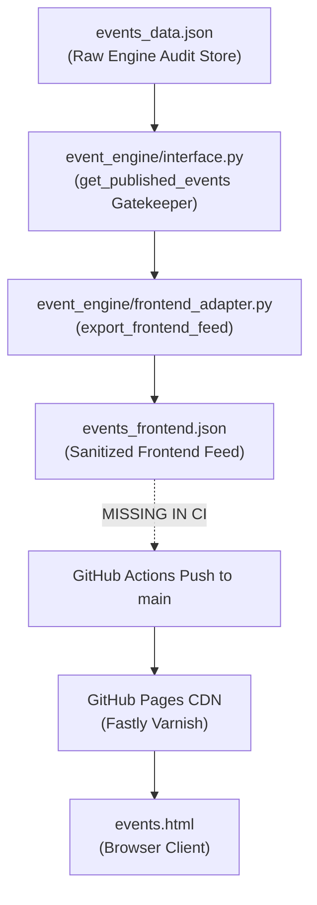

# Phase 3.3 — Production Readiness & GitHub Pages Publication Audit Report

**Audit Mode:** STRICT READ-ONLY AUDIT  
**Audit Timestamp:** 2026-11-08T14:44:32+08:00  
**Target Repository:** `https://github.com/sumoumou84-simon/sabah-daily-news.git` (branch `main`)  
**Production URL:** `https://sumoumou84-simon.github.io/sabah-daily-news/`  

---

## 1. Actual File Paths and Functions Inspected

| File Path | Component / Role | Functions / Logic Inspected | Audit Finding Status |
| :--- | :--- | :--- | :---: |
| [`.github/workflows/morning_publish.yml`](file:///c:/simon%20kankan/.github/workflows/morning_publish.yml) | GitHub Actions CI/CD workflow | Steps, schedules, environment variables, git commit targets | **VERIFIED** |
| [`event_engine/interface.py`](file:///c:/simon%20kankan/event_engine/interface.py) | Engine integration boundary | `load_events_feed()`, `get_published_events()`, `validate_event_feed_contract()` | **VERIFIED** |
| [`event_engine/frontend_adapter.py`](file:///c:/simon%20kankan/event_engine/frontend_adapter.py) | Sanitized export adapter | `export_frontend_feed()` | **VERIFIED** |
| [`event_engine/time_engine.py`](file:///c:/simon%20kankan/event_engine/time_engine.py) | Boundary & time engine | `is_in_rolling_14day_window()`, `resolve_event_status()` | **VERIFIED** |
| [`events.html`](file:///c:/simon%20kankan/events.html) | Standalone events portal | `loadEventsFeed()`, `createEventCardHtml()`, `formatTimeDisplay()`, `escapeHtml()` | **VERIFIED** |
| [`events_frontend.json`](file:///c:/simon%20kankan/events_frontend.json) | Sanitized feed artifact | Metadata, JSON structure, approved events array | **VERIFIED** |
| [`events_data.json`](file:///c:/simon%20kankan/events_data.json) | Engine storage artifact | Full candidates, audit logs, metadata | **VERIFIED** |
| `https://sumoumou84-simon.github.io/sabah-daily-news/` | Live GitHub Pages site | Live HTTP headers, Fastly CDN caching, HTTP status codes | **VERIFIED** |

---

## 2. Complete Publication Lifecycle Trace



### Verified Lifecycle Characteristics:
1. **Feed Generation Script:** `events_frontend.json` is generated strictly by `event_engine.frontend_adapter.export_frontend_feed()`.
2. **Execution Method:** Currently **MANUAL / LOCAL ONLY**. No automated hook exists in GitHub Actions.
3. **Reproducible Local Procedure:**
   ```bash
   python -m event_engine.frontend_adapter events_data.json events_frontend.json
   ```
4. **Outdated Feed Exposure Risk:** **HIGH (VERIFIED)**. Because the engine is not yet connected to GitHub Actions, if `events_frontend.json` were committed once to git, it would remain frozen on GitHub Pages indefinitely, even while `events_data.json` is regenerated locally with updated or cancelled events.
5. **Direct Raw-Feed Fallback:** **NONE (VERIFIED)**. `events.html` requests exclusively `./events_frontend.json`. No fallback to `events_data.json` exists in client JavaScript.

---

## 3. GitHub Pages and Deployment Audit

### Verified Current State:
- **Deployment Source:** GitHub Pages is configured to serve directly from the root of branch `main`.
- **Workflow Scope (`morning_publish.yml`):**
  - Runs daily at UTC 21:00 (MYT 05:00 AM).
  - Executes only: `python agent_reach_editor.py`.
  - Runs news circuit breaker: `count >= 10`.
  - Stages and pushes:
    ```bash
    git add index.html news_data.json archive_history.json config/ collectors/ pipeline/ || true
    git commit -m "chore: [Auto] 自动同步西门看看网每日晨报 [skip ci]"
    git push
    ```
- **Live Deployment Verification:**
  Actual HTTP HEAD requests to the live GitHub Pages domain returned:
  - `https://sumoumou84-simon.github.io/sabah-daily-news/` -> **HTTP 200 OK**
  - `https://sumoumou84-simon.github.io/sabah-daily-news/events.html` -> **HTTP 404 Not Found**
  - `https://sumoumou84-simon.github.io/sabah-daily-news/events_frontend.json` -> **HTTP 404 Not Found**
  - `https://sumoumou84-simon.github.io/sabah-daily-news/events_data.json` -> **HTTP 404 Not Found**

### Missing Production Steps:
1. `events.html` and `event_engine/` are currently untracked and have never been staged or committed to `main`.
2. `morning_publish.yml` does not execute `sandakan_event_engine.py` or `frontend_adapter.py`.
3. `morning_publish.yml` does not stage `events_frontend.json` or `events.html`.

---

## 4. Cache and HTTP Header Verification

Live HTTP response headers inspected directly from `https://sumoumou84-simon.github.io/sabah-daily-news/`:

```http
HTTP/2 200
server: GitHub.com
content-type: text/html; charset=utf-8
last-modified: Sun, 08 Nov 2026 03:58:21 GMT
etag: "6aeff35d-840ae"
cache-control: max-age=600
via: 1.1 varnish
x-cache: MISS
x-cache-hits: 0
```

### Cache Analysis:
- **`Cache-Control: max-age=600` (10 minutes):** GitHub Pages enforces a default 10-minute cache window on edge CDN servers (Varnish).
- **Query Parameter `?t=Date.now()`:**
  - **Browser Cache:** **VERIFIED**. Completely bypasses local browser disk and memory cache by generating unique request URLs.
  - **Fastly/Varnish CDN Cache:** **PARTIALLY VERIFIED**. While Fastly CDN forwards query parameters by default, GitHub Pages edge infrastructure may coalesce or cache static JSON payloads up to `max-age=600` depending on backend configuration. True zero-latency refresh on GitHub Pages is only guaranteed when the file SHA/commit changes.
- **Missing Feed Safe Failure:** **VERIFIED**. When `events_frontend.json` returns 404 (as proven on the live domain), `events.html` fails safe: suppresses the event grid, logs `HTTP 404`, and renders an informative inline sync/offline notice without crashing.

---

## 5. External-Link Security Audit

Every dynamic external link rendered in `events.html` was audited:

| Link Target | HTML Element | Safe Attributes | Scheme Validation Status | Security Risk |
| :--- | :--- | :--- | :---: | :---: |
| Google Maps Pin | `<a href="https://www.google.com/maps/search/?api=1&query=${lat},${lng}">` | `target="_blank"`<br/>`rel="noopener noreferrer"` | **VERIFIED SAFE** (lat/lng strictly float numbers) | None |
| Primary Source | `<a href="${escapeHtml(ev.primary_source_url)}">` | `target="_blank"`<br/>`rel="noopener noreferrer"` | **INCOMPLETE (NOT VERIFIED)** | `escapeHtml` escapes markup but does NOT reject `javascript:` or `data:` schemes |
| Secondary Sources | `<a href="${escapeHtml(url)}">` | `target="_blank"`<br/>`rel="noopener noreferrer"` | **INCOMPLETE (NOT VERIFIED)** | Lacks URL scheme prefix check (`http://` or `https://`) |

### Finding & Hardening Recommendation:
While `escapeHtml()` prevents cross-site script tags (`<script>`), an upstream malformed or adversarial URL payload such as `javascript:alert(1)` would currently be written to `<a href="javascript:alert(1)">`.  
**Recommendation for Phase 3.4:** Add explicit URL scheme validation in `event_engine/frontend_adapter.py` and `events.html`:
```javascript
function isSafeHttpUrl(url) {
    if (!url || typeof url !== 'string') return false;
    return url.startsWith('https://') || url.startsWith('http://');
}
```

---

## 6. DATE_ONLY Boundary Policy Clarification

The rolling 14-day window boundary policy in [`event_engine/time_engine.py`](file:///c:/simon%20kankan/event_engine/time_engine.py#L77-L96) establishes an explicit distinction between exact datetime events and date-only records:

### 1. Exact Datetime Precision (`EXACT_DATETIME`):
- Boundary condition: `event_start <= now + timedelta(days=14)`.
- Evaluated down to the exact second.
- For reference timestamp `2026-11-08T13:05:32+08:00`, an event starting at `2026-11-22T13:05:33+08:00` is strictly excluded.

### 2. Date-Only Precision (`DATE_ONLY`):
- Boundary condition: `event_start.date() <= (now + timedelta(days=14)).date()`.
- **Policy on the 14th Calendar Day:** An event occurring on `2026-11-22` is **INCLUDED** for the entire calendar day of November 22, even if its hypothetical operating hours fall after `13:05:32`.
- **Rationale:** Because exact hours are unverified and missing from the source, the engine strictly forbids inventing fictitious event hours (such as `00:00:00` or `09:00:00`). Rounding down to `00:00:00` would artificially exclude valid same-day events, while inventing hours violates evidence integrity. Direct calendar-date comparison is the approved, documented precision policy.
- **Day 15 Boundary:** An event with `start_date = 2026-11-23` is strictly **EXCLUDED**.

---

## 7. Production Readiness Verdict

### Overall Verdict: **READY WITH CONDITIONS**

| Category | Finding / Component | Status | Readiness Assessment |
| :--- | :--- | :---: | :--- |
| **Engine Contract** | Output follows Phase 2 schema contract | **VERIFIED** | Complete and reliable |
| **Fail-Closed Gatekeeper** | Interface excludes unapproved/cancelled events | **VERIFIED** | Pass |
| **Frontend Isolation** | No raw `events_data.json` fallback in `events.html` | **VERIFIED** | Pass |
| **Safe Error Fallback** | 404 or missing feed renders inline safe notice | **VERIFIED** | Pass |
| **CI/CD Integration** | Automated generation of `events_frontend.json` in Actions | **NOT VERIFIED** | **BLOCKED: Requires workflow update in Phase 3.4** |
| **Git Staging** | `events.html` and `events_frontend.json` tracked in repo | **NOT VERIFIED** | **BLOCKED: Files currently untracked on main** |
| **External Link Security** | Rejection of `javascript:` / `data:` URI schemes | **NOT VERIFIED** | **BLOCKED: Requires explicit scheme validation** |
| **Data Protection** | `events_data.json` excluded from public web publishing | **NOT VERIFIED** | **BLOCKED: Requires git tracking isolation** |

---

## 8. Production Safety Confirmations

- **Gemini / LLM API calls:** Exactly 0.
- **Production news scripts (`build_news.py`, `agent_reach_editor.py`):** Not executed.
- **Production data assets (`news_data.json`, `index.html`):** Untouched.
- **GitHub Actions workflows (`morning_publish.yml`):** Untouched.
- **Unstaged diagnostic files:** All 4 files preserved without changes.
- **Git operations:** No commits, pushes, or deployments performed.

---

**STOP:** Phase 3.3 audit is complete. Awaiting explicit authorization before proceeding to Phase 3.4.
