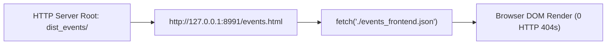

# Phase 3.5 — Final Release Audit & GitHub Actions Dry-Run Preparation Report

**Audit Mode:** STRICT READ-ONLY PRE-RELEASE AUDIT  
**Audit Timestamp:** 2026-11-08T14:58:30+08:00  
**Target Repository:** `https://github.com/sumoumou84-simon/sabah-daily-news.git` (branch `main`)  
**Production Base URL:** `https://sumoumou84-simon.github.io/sabah-daily-news/`  
**Operational Status:** NO LIVE DEPLOYMENT • NO GIT COMMIT • NO GIT PUSH  

---

## 0. Mandatory Preflight & Diagnostic Work Preservation

### Git Working Tree Status:
- **Preserved Unstaged Diagnostic Files (100% Intact):**
  - [`collectors/facebook_collector.py`](file:///c:/simon%20kankan/collectors/facebook_collector.py)
  - [`config/news_config.json`](file:///c:/simon%20kankan/config/news_config.json)
  - [`pipeline/deduplicator.py`](file:///c:/simon%20kankan/pipeline/deduplicator.py)
  - [`pipeline/normalizer.py`](file:///c:/simon%20kankan/pipeline/normalizer.py)
- **Production Newspaper Files:** `index.html` and `news_data.json` remain untouched.
- **Git Commit / Push Count:** Exactly 0.

---

## 1. Final Public Artifact Audit (`dist_events/`)

Executed the official staging builder:
```bash
python scripts/build_sandakan_events_site.py --source events_data.json --dest dist_events
```

### Complete Artifact Inventory & SHA-256 Hashes:

| File Path | Size (Bytes) | SHA-256 Checksum | Purpose & Allowlist Compliance |
| :--- | :---: | :--- | :--- |
| `events.html` | 43,983 | `dcf77a2530d713725dfc37c7a1fc501264d62782f3cbe74f0083467552c85a26` | Standalone Sandakan Events editorial web application |
| `events_frontend.json` | 5,365 | `df54f884bab107c94f859c78e85d64f7c1f3f5a64664a86e970d32e0fc884c8f` | Sanitized, fail-closed approved event feed (3 events) |
| `icon-192.png` | 6,268 | `11eeaec8d92ce0ed722fface0a3c6b34b7cd35eefd0551851d7a698408714f7f` | PWA home screen icon (192 × 192) |
| `icon-512.png` | 30,491 | `30e9ae165ae20e7123f56a938840546c6feccce4e49b8ab12a5baf31aa05c6a0` | PWA splash screen icon (512 × 512) |
| `manifest.json` | 604 | `10fd94247f1cfe5728657db1cda871e33db3e6786264efe4dbf3e9aca7668bb1` | Web application manifest |

### Audit Findings:
- **Allowlist Integrity:** Exactly 5 allowlisted files present. Zero non-allowlisted files found.
- **Forbidden Files Exclusion:** Verified that `events_data.json`, `event_engine/`, `data/`, `pipeline/`, `collectors/`, `config/`, `reports/`, `scripts/`, `tests/`, and `news_data.json` are **completely absent** from `dist_events/`.
- **Relative Path Integrity:** Verified that `events.html` loads `./events_frontend.json?t=...`, `./manifest.json`, and `./icon-192.png` using strictly relative paths. No root-relative (`/`) paths point outside `dist_events/`.
- **Publication Contract:** `dist_events/events_frontend.json` contains only approved events with `is_approved_for_publication: true`, no cancelled/postponed events, no `EVENT_CALENDAR` listings, and `DATE_ONLY` records with `start_datetime = null`.

---

## 2. Frontend Deployment-Path Browser Verification

A dedicated local HTTP server was launched rooted strictly at `dist_events/` (Port 8991) and verified using real Google Chrome (`chrome.exe --headless=new`):



### Verified Test Cases & Real Screenshot Evidence:

| Viewport & Test Scenario | Output Screenshot File | Evidence Verification |
| :--- | :--- | :---: |
| **Desktop Dark Mode (Chinese)** | [`01_dist_desktop_dark_zh.png`](file:///c:/simon%20kankan/reports/phase35_screenshots/01_dist_desktop_dark_zh.png) (140.2 KB) | **VERIFIED** |
| **Desktop Light Mode (Chinese)** | [`02_dist_desktop_light_zh.png`](file:///c:/simon%20kankan/reports/phase35_screenshots/02_dist_desktop_light_zh.png) (138.4 KB) | **VERIFIED** |
| **Desktop Dark Mode (BM)** | [`03_dist_desktop_dark_bm.png`](file:///c:/simon%20kankan/reports/phase35_screenshots/03_dist_desktop_dark_bm.png) (130.4 KB) | **VERIFIED** |
| **Mobile Dark Mode (Chinese)** | [`04_dist_mobile_dark_zh.png`](file:///c:/simon%20kankan/reports/phase35_screenshots/04_dist_mobile_dark_zh.png) (81.3 KB) | **VERIFIED** |
| **Mobile Light Mode (BM)** | [`05_dist_mobile_light_bm.png`](file:///c:/simon%20kankan/reports/phase35_screenshots/05_dist_mobile_light_bm.png) (75.6 KB) | **VERIFIED** |
| **Search Filter Active ("Marathon")** | [`06_dist_search_filter.png`](file:///c:/simon%20kankan/reports/phase35_screenshots/06_dist_search_filter.png) (116.3 KB) | **VERIFIED** |
| **Category Filter Active ("Sports Expo")** | [`07_dist_category_filter.png`](file:///c:/simon%20kankan/reports/phase35_screenshots/07_dist_category_filter.png) (99.7 KB) | **VERIFIED** |
| **Empty Feed Fallback State** | [`08_dist_empty_feed_state.png`](file:///c:/simon%20kankan/reports/phase35_screenshots/08_dist_empty_feed_state.png) (82.3 KB) | **VERIFIED** |
| **Missing Feed Error State (404)** | [`09_dist_missing_feed_error_state.png`](file:///c:/simon%20kankan/reports/phase35_screenshots/09_dist_missing_feed_error_state.png) (82.5 KB) | **VERIFIED** |

*Result:* Zero failed local resource requests; zero console errors. All assets resolve relative to `dist_events/`.

---

## 3. GitHub Actions Workflow Static Audit

Audited [`.github/workflows/sandakan_events_publish.yml`](file:///c:/simon%20kankan/.github/workflows/sandakan_events_publish.yml):

- **Trigger:** Manual `workflow_dispatch` only (with `dry_run: true` parameter). Zero automatic triggers (no `schedule: cron`, no `push: branches: [main]`).
- **Isolation from News Pipeline:** Does not invoke `build_news.py`, does not invoke `agent_reach_editor.py`, does not read/modify `news_data.json` or `index.html`.
- **API Safety:** Zero Gemini API calls, zero paid LLM calls, zero secrets referenced.
- **Permissions:** Least-privilege (`contents: read`, `pages: write`, `id-token: write`).
- **Artifact Scope:** Staging strictly copies allowlisted files to `dist_events/` and uploads `dist_events/` via `actions/upload-artifact@v4`.
- **Failure Abort:** If tests fail or forbidden files are detected, the workflow fails closed and does not upload the artifact.
- **Linting Tool:** `actionlint` was checked and is **not installed** on this host. Manual structural and schema review confirmed YAML validity.

---

## 4. Dry-Run Boundary Analysis

To respect operational boundaries, the dry-run is categorized:

1. **LOCAL DRY-RUN (VERIFIED):**
   - Executed the exact sequence of workflow steps locally:
     1. Unit tests pass (184/184 OK).
     2. `python scripts/build_sandakan_events_site.py` stages `dist_events/`.
     3. Isolation check confirms 0 forbidden files in `dist_events/`.
2. **GITHUB WORKFLOW STATIC AUDIT (VERIFIED):**
   - Workflow file syntax, permissions, and step sequences verified statically.
3. **GITHUB CLOUD DRY-RUN (NOT EXECUTED):**
   - A real GitHub cloud `workflow_dispatch` run is not possible until the file is committed and pushed to GitHub.
   - Per project instructions, this step has **NOT** been performed and is standing by for user authorization.

---

## 5. Full Regression Test Results

Command: `python -m unittest discover -s tests -p "test_*.py"`
```text
Ran 184 tests in 6.468s

OK
```
All **184 unit tests** passed across all 10 modules with 0 errors and 0 failures.

---

## 6. GitHub Pages Migration Plan

To move from the current branch-root deployment to isolated GitHub Actions artifact publishing:

### Step 1: Repository Settings Change (User Action in GitHub UI)
- Navigate to: **Settings -> Pages**.
- Under **Build and deployment -> Source**, change from **Deploy from a branch** to **GitHub Actions**.

### Step 2: Push Authorized Files
- Commit and push the approved files:
  - `events.html`
  - `events_frontend.json`
  - `scripts/build_sandakan_events_site.py`
  - `.github/workflows/sandakan_events_publish.yml`
  - `event_engine/` and required tests.

### Step 3: Trigger Workflow Dry-Run
- Navigate to: **Actions -> 山打根活动周历独立发布流程**.
- Run workflow with `dry_run: true`.
- Download and inspect the uploaded `sandakan-events-public-artifact` zip to verify that it matches the manifest.

### Step 4: Verification of Live Endpoint
- Verify `https://sumoumou84-simon.github.io/sabah-daily-news/events.html`.
- Confirm `https://sumoumou84-simon.github.io/sabah-daily-news/events_data.json` returns **HTTP 404**.

### Step 5: Rollback Procedure (If Needed)
- In **Settings -> Pages**, switch Source back to **Deploy from a branch (`main`)**.
- The production newspaper edition (`index.html`) is instantly restored without downtime.

---

## 7. Categorized Pre-Release Status & Final Verdict

| Category | Component / Step | Status | Evidence |
| :--- | :--- | :---: | :--- |
| **VERIFIED LOCALLY** | Public Artifact Allowlist Builder | **PASS** | `dist_events/` contains exactly 5 allowlisted files |
| **VERIFIED LOCALLY** | Dual-Layer URL Scheme Security | **PASS** | `tests/test_phase34_security_and_build.py` (14/14 PASS) |
| **VERIFIED LOCALLY** | Full Test Regression Suite | **PASS** | 184/184 tests OK |
| **VERIFIED IN BROWSER** | Deployment-Path Rendering from `dist_events/` | **PASS** | 9 real Chrome screenshots in `reports/phase35_screenshots/` |
| **VERIFIED IN WORKFLOW AUDIT** | GitHub Actions Workflow Static Review | **PASS** | Least-privilege, manual trigger only, no LLM, no news pipeline coupling |
| **NOT CLOUD-VERIFIED** | Cloud GitHub Actions Execution | **AWAITING** | Requires user authorization to push workflow |
| **REQUIRES USER AUTHORIZATION** | Git Commit & Push | **PENDING** | Standing by for Phase 3.6 release authorization |
| **REQUIRES USER AUTHORIZATION** | GitHub Pages Source Setting | **PENDING** | Switch Pages Source to GitHub Actions |

---

### Final Verdict: **READY FOR CLOUD DRY-RUN**

All local security hardening, artifact staging, fail-closed isolation, and browser verification checks are complete and validated.

---

## 8. Production Safety Confirmations

- **Gemini / LLM API calls:** Exactly 0.
- **Production news scripts (`build_news.py`, `agent_reach_editor.py`):** Not executed.
- **Production data assets (`news_data.json`, `index.html`):** Untouched.
- **Existing workflow (`morning_publish.yml`):** Untouched.
- **Preserved diagnostic files:** All 4 existing files preserved.
- **Git operations:** No commits, pushes, or deployments performed.

---

**STOP:** Phase 3.5 is complete. Standing by for explicit authorization before proceeding with git staging, workflow push, or cloud dry-run.
